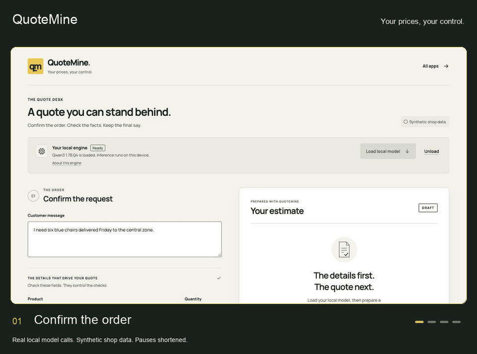

# QuoteMine

### Your prices, your control.

A local quote desk for an independent shop. Confirm an order, let a QVAC model check stock, price and delivery, then review a clear draft with every check visible.



**Local model. Checked amounts. Your final say.** QuoteMine prepares drafts from synthetic shop data. It does not send quotes, reserve stock, book delivery or take payments.

## Run it

Use Node.js 22.21.0 or a newer version allowed by `package.json`. The `.nvmrc` file selects the tested baseline. QVAC uses native libraries, so use a desktop system supported by the [QVAC SDK](https://github.com/tetherto/qvac/tree/sdk-v0.22.0/packages/sdk).

```sh
git clone https://github.com/victorchimakanu/quotemine.git
cd quotemine
npm ci
npm start
```

Open [http://127.0.0.1:4322](http://127.0.0.1:4322). Click **Load local model**, confirm the order fields, then choose **Prepare draft quote**.

The first model load downloads Qwen3 1.7B Q4 unless it is already cached. Its weights are 1,056,782,912 bytes, about 1.06 GB. Allow extra disk space for the SDK and its native libraries, and enough free memory for the model and a 4,096 token context. Memory use and speed depend on your system. There is no cloud model fallback and no API key.

Use `PORT=4402 npm start` if the default port is busy. Set environment variables using your shell's syntax. Stop the server with Ctrl+C to close the model worker.

## Try two orders

The default request is six blue chairs, delivered to the central zone on the next Friday. Confirm the exact date shown in the form. The message gives the model context; the confirmed product, quantity, zone and date drive the checks. This version does not extract those fields from arbitrary customer text.

| Default draft | USD |
| --- | ---: |
| Six chairs at $42.50 | 255.00 |
| Item tax at 7.5% | 19.13 |
| Central delivery | 15.00 |
| **Total** | **289.13** |

Click **Try low stock** to request six red chairs. Only three are available, so QuoteMine shows the problem and withholds the draft. The north zone on a Friday also fails its delivery check. Central delivery runs on weekdays; north delivery runs on Tuesdays and Thursdays. Dates use UTC, with one day of notice and a 30 day booking window.

A successful result includes a structured estimate, a plain text draft, the actual tool call trace and an optional model note. Copy or download the draft for review. Changing the confirmed inputs clears the previous result so an old quote cannot be copied by mistake.

## How it works

1. **Confirm.** The server validates the product, whole quantity, delivery zone and date.
2. **Check.** Qwen3 can request `check_stock`, `get_price` and `check_delivery`. Each call must match the confirmed order exactly.
3. **Run together.** Independent calls returned in the same model turn run through `Promise.all`.
4. **Calculate.** Code computes the total in integer cents. Tax uses half-up rounding. The model cannot set amounts.
5. **Review.** A draft is available only after all required checks pass and no tool call is refused. The optional model note is labelled unverified and cannot change the quote.

This uses [QVAC SDK 0.22.0](https://github.com/tetherto/qvac/releases/tag/sdk-v0.22.0), with `parallel_tool_calls` inside `generationParams`:

```js
const run = sdk.completion({
  modelId,
  history,
  tools,
  stream: true,
  generationParams: {
    temp: 0,
    predict: 768,
    reasoning_budget: 0,
    tool_choice: 'required',
    parallel_tool_calls: true
  }
});
const result = await run.final;
```

Parallel tool calls let the model return several calls in a turn; they do not guarantee a batch of three. The trace reports the actual calls and largest returned batch. QuoteMine allows up to three tool turns if the model chooses one check at a time. Handler times describe tiny local data checks, not a cloud performance benchmark.

Tool results go back to the local model using structured history. Assistant messages carry `toolCalls`; each result includes its `toolCallId` and `toolName`. The model's optional note comes from `contentText`. See the [tagged inference schema](https://github.com/tetherto/qvac/blob/sdk-v0.22.0/packages/inference/src/schemas/completion-stream.ts) for the underlying request format.

## Data, privacy and limits

The three files in [`src/data/`](src/data/) contain **synthetic data**: stock, USD prices, demo item tax and fictional delivery zones. Each snapshot has an `asOf` date. A new `checkedAt` timestamp means the file was read again; it does not make the shop data current. Replace the datasets and review the business rules before adapting this to a real shop.

The web server listens on `127.0.0.1` only. It rejects foreign host and origin headers. Inference runs on your device through QVAC. This app sends no customer messages to a cloud inference service, uses no analytics and serves its fonts locally. Dependency installation and uncached model downloads require network access. QVAC stores model weights in its local cache; unloading keeps those weights for later use.

The server holds the current model in memory. Quote results stay in the browser until you leave or reload the page. Copying uses your clipboard; downloading creates a local text file. The app has no order database, messaging integration, live inventory or payment integration. A draft still needs human review.

Tool names are allowlisted. Extra arguments, unknown tools, duplicate calls in a batch and mismatched order values are refused. Customer text stays data, and browser output uses `textContent`. Model output is never executed as code or HTML. These checks limit what an injected prompt can do; the unverified model note can still be wrong.

### Use an existing local model

You can provide a compatible local, tool-capable GGUF model through a server environment variable:

```sh
QUOTE_MODEL_PATH=/absolute/path/to/model.gguf npm start
```

The path must be absolute. The default configuration uses 4,096 context tokens, tools enabled and reasoning disabled. A custom model may return different calls or fail the checks; the app keeps the same validation rules. Browser requests cannot choose paths or add tools.

### Troubleshooting

- **The first load takes time:** the model download is about 1.06 GB. Check the visible progress and available disk space.
- **A download fails:** retry after checking your connection. Already cached catalog weights are reused only after size and checksum validation.
- **A native library fails to load:** use the supported Node version and install dependencies with normal `npm ci`. The CI command below skips native install scripts and is only for tests.
- **A quote needs review:** inspect the stock, delivery and tool trace. Confirm the requested fields and choose an allowed date.
- **The model times out:** a model turn is cancelled after 120 seconds. Try again or unload the model when the current task ends.

## Develop and test

```sh
npm test
```

The test suite covers whole-cent amounts, tax rounding, UTC dates, low stock, unsupported delivery, strict tool arguments, untrusted text, parallel handlers, actual batch reporting, structured history, model lifecycle, HTTP boundaries and stale UI results. SDK stubs are confined to tests. The running app has no pretend model mode.

CI uses Node.js 22.21.0 and `npm ci --ignore-scripts` to test the pure JavaScript logic and installed SDK schema without downloading native runtime assets or model weights. To run inference, use the normal installation in the quickstart.

| File | Role |
| --- | --- |
| [`src/core.mjs`](src/core.mjs) | Validation, three tools, parallel batches and checked quote totals |
| [`src/runtime.mjs`](src/runtime.mjs) | Model loading, completion, cancellation and cleanup |
| [`src/server.mjs`](src/server.mjs) | Local API and server startup |
| [`src/public/`](src/public/) | Quote desk, result sheet and visible tool trace |
| [`src/data/`](src/data/) | Synthetic stock, prices and delivery policy |
| [`shared/`](shared/) | Local HTTP boundaries and verified cache lookup |
| [`src/test/`](src/test/) | Quote, runtime and UI checks |
| [`src/design-dna.json`](src/design-dna.json) | Visual system, style and effects profile |

The app uses locally hosted Manrope. Font licenses are included in [`src/public/fonts/`](src/public/fonts/). Application code is [MIT licensed](LICENSE). QVAC and its native dependencies retain their own licenses.

Explore the companion apps: [PocketPacts](https://github.com/victorchimakanu/pocketpacts) and [ModelGarage](https://github.com/victorchimakanu/modelgarage).
